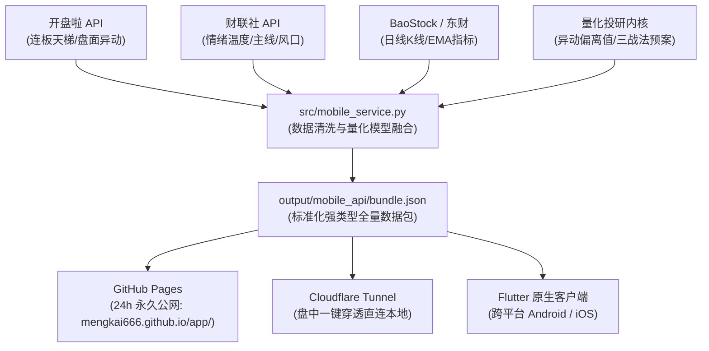

# 📊 A股量化投研与主线强度追踪终端 (Quant Factor Terminal)
> **全天候主线追踪 · 严重异动安全雷达 · 情绪周期量化 · 三战法实战推演预案**  
> *专为超短线交易者、量化研究员与高阶投资社群/会员打造的沉浸式复盘与决策产品*

---

## 🌐 线上体验与公网产品直达

| 访问方式 | 适合场景 | 依赖本地电脑开机？ | 专属访问链接 / 启动方式 |
| :--- | :--- | :---: | :--- |
| **🌍 24小时永久公网站 (PWA)** | 日常复盘、会员长期使用、微信/朋友直接分享 | ❌ **无需开机** (全球CDN稳定加速) | 👉 **[https://mengkai666.github.io/app/](https://mengkai666.github.io/app/)** |
| **⚡ 盘中电脑实时直连穿透** | 交易时段（9:30-15:00）实时盯盘、直连本地Python计算引擎 | ✔️ **需开启脚本** | 👉 根目录双击 **[`启动公网移动端服务.bat`](file:///c:/Users/mengk/Desktop/quant_factor_tutorial/启动公网移动端服务.bat)** |

> 📱 **移动端极简体验提示**：使用手机微信或 Safari / Chrome 浏览器打开上述链接后，点击右上角或底部菜单选择 **「添加到主屏幕」**，桌面即可自动生成独立 App 图标，全屏秒开、沉浸式操作，体验与原生 App 100% 一致！

---

## 📌 产品定位与解决的痛点

在传统的 A 股短线与超短接力交易中，投资者往往面临四大核心痛点：
1. **复盘耗时且信息割裂**：需要反复切换通达信、同花顺、开盘啦、财联社、东方财富等多个软件，每天收盘手工统计花费 2~3 小时；
2. **监管踩坑（严重异动关小黑屋）**：高位打板最怕吃交易所“10日100%”或“30日200%”严重异常波动停牌核查，由于缺乏精确的数学偏离度测算，常被主力资金主动断板砸在山顶；
3. **主线题材真假难辨**：盘中轮动题材五花八门，分不清哪些是主力真金白银抱团的核心主线，哪些是日内脉冲跟风杂毛；
4. **研报冗长缺乏可执行性**：传统券商研报晦涩繁琐，缺少明确到“买入触发价、硬性止损线、失效放弃条件”的次日实战推演。

**本项目将深厚的量化投研模型与极简移动端产品设计融为一体**，致力于让交易者在手机上一屏看懂市场大势、锚定真主线、提前规避异动风险、并严格执行战法纪律。

---

## ✨ 四大杀手级核心产品功能

### 1. ⚡ 严重异动安全雷达与速算器 (排雷避坑神器)
- **监管偏离度精确建模**：内置交易所最新监管规则（10 个交易日内收盘价偏离值达 100%、30 个交易日内偏离值达 200%），结合个股与对应分类指数，滚动测算安全垫余量。
- **高标标的分级预警**：
  - 🟢 **安全垫充裕**：距离红线尚有 2 个以上涨停板空间；
  - 🟡 **警戒防断板**：距离红线仅剩 1~2 个板，提示主力资金极可能主动断板横盘规避监管；
  - 🔴 **极度危险**：次日若涨停直接触碰 100% 红线，面临停牌核查与重点监控风险。
- **🧮 交互式涨幅速算器**：输入股票代码或现价，支持模拟“主板+10%”或“创业/科创+20%”，一键测算次日收盘偏离度与安全结论。

### 2. 🌊 主线强弱热力榜与新老周期解构
- **主线阵营提炼**：聚合财联社与开盘啦真实资金流，计算各大主线板块综合强度评分与涨停家数；
- **生命周期状态标签**：
  - 🔥 **主升共振阶段**：资金聚焦，适合顺势围绕前排接力；
  - ⚡ **轮动发酵阶段**：题材扩散，注意防范后排中途掉队；
  - ⚖️ **高位分歧阶段**：分化博弈，禁止盲目追高，等待弱转强；
  - ❄️ **冲高退潮阶段**：资金出清，果断防守止盈。
- **梯队标杆胶囊**：板块内清晰提炼 **👑 领涨龙一**、**⚔️ 身位龙二**、**🛡️ 容量中军**，展示实时涨幅与核心驱动逻辑。

### 3. 🎯 三战法实战推演与预案作战室
- **结构化推演卡片**：彻底杜绝模糊模棱两可的分析，每只观察标的均严格按照交易三要素呈现：
  - 🟢 **买入触发条件**：分时量比、开盘承接、回踩均价线确认价位；
  - 🔴 **硬性止损底线**：跌破昨日收盘价或关键支撑位的绝对离场位；
  - ⚪ **失效放弃条件**：大幅低开直接破位或空间板决裂时的作废规则。
- **三大实战战法矩阵**：
  - **战法 A · 严重异动低吸战法**：高标主动断板横盘 2~5 日，滚动偏离度指标骤降时低吸布局二波；
  - **战法 B · 强势股抱团突破战法**：大主线核心龙头回踩 EMA5/EMA20 企稳后的放量反包；
  - **战法 C · 可转债 T+0 日内套利战法**：正股涨停封死瞬间，利用对应可转债 T+0 极致机动性套利。

### 4. 🌡️ 全市场情绪周期温度计与连板天梯
- **多空决策红绿灯**：🟢 顺势进攻 / 🟡 防守试错 / 🔴 冰点熔断，一秒明确今日可否操作及建议仓位；
- **全方位市场全景**：0~100 情绪度数、两市成交总额与增减量、涨跌区间直方分布图、昨日涨停赚钱效应指数；
- **连板天梯可视化**：从全市场最高板（如 8B、5B）逐级向下展现梯队身位与淘汰率。

---

## 📱 全平台产品交付矩阵

```
┌────────────────────────────────────────────────────────────────────────┐
│                        A股量化投研与主线追踪终端                       │
├───────────────────┬───────────────────┬────────────────────────────────┤
│ 📱 移动端 Web/PWA │ 📲 Flutter 原生端 │ 💻 桌面端深度投研大屏          │
├───────────────────┼───────────────────┼────────────────────────────────┤
│ • 零门槛免安装    │ • 60FPS 流畅动效  │ • 万字级量化深度研报           │
│ • 支持手机添加到桌面│ • TradingView K线 │ • 缠论结构与买卖点分析         │
│ • 极简深色暗黑主题│ • 原生触控手势缩放│ • 历史 31+ 交易日对账回测      │
│ • 微信/朋友圈秒发 │ • 离线数据持久化  │ • ECharts 多维可视化图表       │
└───────────────────┴───────────────────┴────────────────────────────────┘
```

---

## 🛠️ 自动化流水线与数据工程架构

系统底层拥有极其严密的工业级数据工程与容灾体系：



### 常用运行与发布命令：

| 任务说明 | 执行命令 | 说明 |
| :--- | :--- | :--- |
| **一键启动公网服务** | 双击运行 [`启动公网移动端服务.bat`](file:///c:/Users/mengk/Desktop/quant_factor_tutorial/启动公网移动端服务.bat) | 自动启动本地数据服务 + 建立公网 HTTPS 隧道 + 复制链接至剪贴板 |
| **盘后全量推送到公网** | `python tools/publish_to_github_io.py` | 盘后自动更新数据并发布至 24 小时永久公网 |
| **单跑移动端数据生成** | `python src/mobile_service.py` | 重新抓取行情，更新 `bundle.json` 与异动雷达 |
| **启动本地纯局域网服务** | `python tools/run_mobile_server.py` | 仅在本地 8088 端口提供 HTTP 服务 |

---

## 💼 商业化变现与会员权益规划

面向朋友内测、知识星球、高阶会员社群或独立 SaaS，产品采用清晰的权益分层：

| 用户层级 | 定位 | 开放核心权益 | 交付场景与形式 |
| :--- | :--- | :--- | :--- |
| **基础用户 / 朋友体验** | 大盘与主线总览 | • 每日全市场情绪温度与红绿灯总开关<br>• 连板天梯梯队分布<br>• 基础主线板块涨跌概览 | 免费访问永久公网链接，建立口碑与用户信任 |
| **标准会员 (月/季费)** | 避坑与盯盘工具 | • ✅ **严重异动安全雷达与速算器**（排雷神器）<br>• ✅ 主线强弱热力榜（龙一/龙二/中军胶囊）<br>• ✅ 重点高标个股资金承接监控 | 适合活跃短线散户、盯盘手，解决日常选股与防踩雷痛点 |
| **VIP 会员 / 专属圈子** | 实战推演作战室 | • ✅ 包含标准会员全部权益<br>• ✅ **每日盘后“三战法条件预案”**（精确买点/止损点）<br>• ✅ 可转债 T+0 日内套利池追踪<br>• ✅ 缠论多周期买卖点与背驰预警 | 高客单价社群交付，专属激活码解锁，提供次日交易推演指南 |

---

## ⚖️ 金融合规与免责声明

1. **客观数据工具属性**：本系统所有情绪指数、主线强度、连板天梯及严重异动安全空间，均基于市场公开数据（行情数据、交易所规则、财务公告）通过数学模型客观计算得出，系统定位为**量化科研、辅助复盘与数据监测工具**。
2. **严守合规底线**：
   - 系统所有推演与战法均采用**条件概率**描述（例如：“若明日早盘分时承接放量突破某价位，历史回测显示具备关注价值”）；
   - 系统严禁且不提供任何形式的主观“荐股服务”、“代客操盘”或“保本收益承诺”。
3. **风险自负提示**：证券市场具有较高的投资风险。投资者在做出任何投资决策前，应根据自身财务状况与风险承受能力独立判断。使用本系统所呈现的数据、图表及推演进行实盘交易，产生的收益与风险均由使用者自行承担，系统开发者不承担任何连带责任。

---

*© 2026 A股量化主线追踪系统 · 由孟锴 (Kai Meng) 核心构建与维护*
